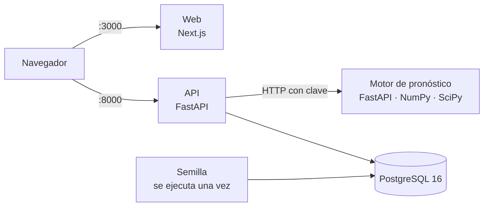

# bria. en tu máquina

Levanta **bria.** completo con un comando: base de datos, motor de pronóstico, API, aplicación web y dos tiendas de prueba con datos cargados. Este repositorio es el punto de partida para evaluar el sistema y para desplegarlo.

**bria.** es un sistema de apoyo a decisiones de inventario para pequeños negocios retail del Perú. Reúne caja, ventas, inventario, compras y proveedores, y a partir de ese historial estima cuánto se venderá de cada producto y qué conviene comprar. La decisión siempre queda en manos del dueño.

| Repositorio | Qué contiene |
|---|---|
| [`bria-web`](https://github.com/bria-app/bria-web) | Aplicación web: Next.js, React y TypeScript |
| [`bria-api`](https://github.com/bria-app/bria-api) | API del negocio: FastAPI, SQLAlchemy y PostgreSQL |
| [`bria-engine`](https://github.com/bria-app/bria-engine) | Motor de pronóstico: FastAPI, NumPy y SciPy |
| `bria-local` (este) | Arranque local, datos de prueba y guía de despliegue |



## Arranque rápido

Necesitas [Git](https://git-scm.com/downloads), [Docker Desktop](https://www.docker.com/products/docker-desktop/) con Compose y unos 8 GB de memoria libres para compilar. Este repositorio trae el dataset y la configuración; el código se descarga de GitHub en el paso 1.

**1. Prepara la carpeta.** Clona `bria-web`, `bria-api` y `bria-engine` dentro de `repos/`, y crea `.env` con claves nuevas.

En Windows:

```powershell
powershell -ExecutionPolicy Bypass -File .\preparar.ps1
```

En Linux o macOS:

```bash
sh preparar.sh
```

**2. Levanta el sistema.** La primera vez tarda varios minutos, porque compila las imágenes.

```bash
docker compose up --build
```

**3. Espera la semilla.** El sistema está listo cuando la consola muestra que el servicio `semilla` terminó con código 0.

**4. Abre la aplicación** en http://localhost:3000.

| Servicio | Dirección |
|---|---|
| Aplicación web | http://localhost:3000 |
| API y su documentación | http://localhost:8000/docs |
| Estado de la API y del motor | http://localhost:8000/api/v1/status |
| Motor de pronóstico | http://localhost:8010/health |
| PostgreSQL | `localhost:5433`, base y usuario `bria` |

## Cuentas de prueba

Las contraseñas se generan al preparar la carpeta y están en tu archivo `.env`.

| Empresa | Rol | Para entrar | Contraseña en `.env` |
|---|---|---|---|
| PetHouse Miraflores | Dueño | `demo30@pethouse.pe` | `DEMO_OWNER_PASSWORD` |
| PetHouse Miraflores | Vendedora | `cvega` | `DEMO_SELLER_PASSWORD` |
| PetHouse Lima | Dueño | `demo@pethouse.pe` | `DEMO_OWNER_PASSWORD` |
| PetHouse Lima | Vendedora | `lramos` | `DEMO_SELLER_PASSWORD` |

Las dos empresas tienen plan Premium y ningún Administrador: créalo en **Configuración › Equipo y permisos**. Para probar el plan Gratis, registra una cuenta nueva en **Crea tu cuenta**.

## Datos de prueba

Todos son **datos sintéticos de una simulación controlada**. Sirven para probar el sistema; no pertenecen a ninguna tienda real y no prueban la precisión del pronóstico en un negocio real. El detalle está en [`datos/README.md`](datos/README.md).

| Dato | Para qué usarlo | Cómo llega |
|---|---|---|
| **PetHouse Miraflores** | Es la base de las pruebas y la tienda de las capturas del manual: 10 productos con ventas, compras, quiebres y ventas perdidas desde mayo de 2024 hasta ayer | Automático |
| **PetHouse Lima** | Segunda empresa, para comprobar que los datos no se cruzan: 12 productos con ventas desde 2022 hasta ayer | Automático |
| [`datos/importables/`](datos/importables) | Excel y CSV para probar la importación de inventario y ventas | Se suben desde la aplicación |

## Pruebas automáticas

Corren fuera de Docker y usan una base SQLite temporal. Necesitan Python 3.11 o superior. Desde `repos/bria-api` o `repos/bria-engine`:

```bash
python -m venv .venv
```

Activa el entorno con `.venv\Scripts\activate` en Windows o `. .venv/bin/activate` en Linux y macOS. Luego:

```bash
pip install -e ".[dev]"
```

```bash
pytest tests -q
```

En `bria-api`, define antes `DATABASE_URL=sqlite://`, porque así la suite no necesita PostgreSQL.

En `repos/bria-web`:

```bash
npm ci
```

```bash
npm run typecheck
```

```bash
npm run lint
```

Los casos de prueba manuales y lo que cada uno necesita están en el **Manual de Usuario**, capítulo «Instalar y ejecutar el sistema».

## Tareas frecuentes

Apagar el motor para probar qué pasa sin él:

```bash
docker compose stop engine
```

Volver a generar PetHouse Miraflores, lo que borra sus datos de prueba y sus corridas:

```bash
docker compose run --rm semilla python /datos/semillas/seed_pethouse_miraflores.py --reiniciar
```

Repetir los mismos datos de las capturas del manual: pon `SEED_HOY=2026-11-04` en `.env` antes del primer arranque.

Apagar todo y conservar los datos:

```bash
docker compose down
```

Borrar todos los datos y empezar de cero:

```bash
docker compose down -v
```

## Si algo falla

| Síntoma | Qué hacer |
|---|---|
| `Falta POSTGRES_PASSWORD` u otra variable | Ejecuta `preparar.ps1` o `preparar.sh` |
| No se pudo clonar un repositorio | Revisa que Git esté instalado, que tengas conexión y que puedas abrir sus enlaces en GitHub |
| Un puerto ya está en uso | Cambia `WEB_PORT`, `API_PORT`, `ENGINE_PORT` o `DB_PORT` en `.env` y vuelve a ejecutar `docker compose up --build` |
| La máquina se queda sin memoria al compilar | Compila de a uno: `docker compose build engine`, luego `api` y luego `web` |
| No puedes entrar con la contraseña de `.env` | Se aplica solo al crear las cuentas. Si cambiaste `.env` después, ejecuta `docker compose down -v` y levanta de nuevo |
| El pronóstico dice que el motor no responde | Revisa http://localhost:8000/api/v1/status y `docker compose logs engine` |
| La web no llega a la API | Si cambiaste `API_PORT`, recompila la web: el valor se fija al compilar |

## Sin Docker

Necesitas Python 3.11 o superior, Node.js 20 y PostgreSQL 16. Abre una terminal por parte, en este orden, y copia antes el `.env.example` de cada repositorio como `.env`.

Motor, en `repos/bria-engine`:

```bash
pip install -e ".[dev]"
```

```bash
uvicorn app.main:app --port 8010
```

API, en `repos/bria-api`. Ajusta `DATABASE_URL` en su `.env` y define `SEED_DEMO=true`, `DEMO_OWNER_PASSWORD` y `DEMO_SELLER_PASSWORD`:

```bash
pip install -e ".[dev]"
```

```bash
alembic upgrade head
```

```bash
python scripts/bootstrap_demo.py
```

```bash
uvicorn app.main:app --port 8000
```

La segunda tienda se carga con esas mismas variables en el entorno, y con `PYTHONPATH` apuntando a `repos/bria-api`:

```bash
python ../../datos/semillas/seed_pethouse_miraflores.py
```

Web, en `repos/bria-web`:

```bash
npm ci
```

```bash
npm run dev
```

## Desplegar

La guía para Railway y Vercel está en [`docs/DESPLIEGUE.md`](docs/DESPLIEGUE.md).

## Sobre el proyecto

Proyecto de tesis de Ingeniería de Software de la Universidad Peruana de Ciencias Aplicadas (TP2026010042). El motor parte del modelo de Ye, Xie, Boylan y Shang (2024), *Forecasting seasonal demand for retail: A Fourier time-varying grey model*, International Journal of Forecasting. Uso académico: el código no se distribuye con licencia abierta.
