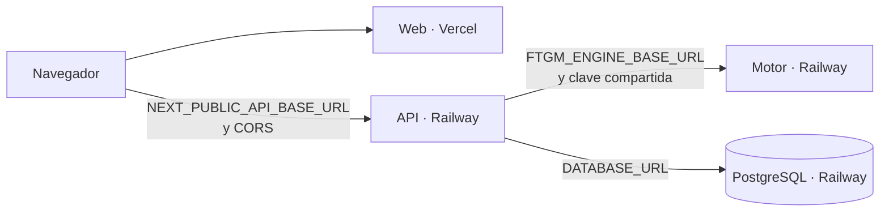

# Despliegue en Railway y Vercel

La topología es: **PostgreSQL, motor y API en Railway; web en Vercel**. Cada repositorio ya trae lo que su plataforma necesita: `Dockerfile` y `railway.json` en `bria-engine` y `bria-api`, y el proyecto Next.js en `bria-web`.



Sigue este orden: el motor no depende de nadie, la API necesita al motor, y la web necesita a la API.

## Nombres

Usa los mismos nombres en todas las plataformas, para reconocer cada pieza:

| Pieza | Plataforma | Nombre | Repositorio |
|---|---|---|---|
| Proyecto | Railway | `bria` | |
| Base de datos | Railway | `bria-db` | |
| Motor de pronóstico | Railway | `bria-engine` | [bria-app/bria-engine](https://github.com/bria-app/bria-engine) |
| API | Railway | `bria-api` | [bria-app/bria-api](https://github.com/bria-app/bria-api) |
| Aplicación web | Vercel | `bria-web` | [bria-app/bria-web](https://github.com/bria-app/bria-web) |

Las plataformas arman la dirección con esos nombres si está libre: por ejemplo, `bria-api-production.up.railway.app` y `bria-web.vercel.app`. La dirección final es la que muestra cada panel.

## Antes de empezar

1. Autoriza a Railway y a Vercel a leer los repositorios de la organización `bria-app`: en cada plataforma, revisa el acceso de su aplicación de GitHub. Los repositorios son privados y de una organización: según reportes de usuarios, para desplegar `bria-web` en Vercel hace falta el plan Pro. Railway se comprueba al desplegar.
2. Genera dos secretos distintos, uno para la clave del motor y otro para las sesiones:

   ```bash
   python -c "import secrets; print(secrets.token_urlsafe(48))"
   ```

3. Elige contraseñas nuevas para las cuentas de demostración. **No reutilices las de despliegues anteriores.**

Si reutilizas un servicio existente, cambia su fuente a estos repositorios en **Settings › Source** en Railway y en **Settings › Git** en Vercel. Si reutilizas la base, las cuentas de demostración conservan sus contraseñas anteriores: cámbialas desde **Configuración › Equipo y permisos**.

## 1. PostgreSQL

En Railway: **New › Database › PostgreSQL**, y nombra el servicio `bria-db`. Railway crea `DATABASE_URL`, y la API la adapta sola a su controlador.

## 2. Motor

1. **New › GitHub Repo › `bria-engine`**.
2. Define la variable:

   | Variable | Valor |
   |---|---|
   | `ENGINE_API_KEY` | Primer secreto |

3. **Settings › Networking › Generate Domain**.
4. Comprueba `https://<motor>/health`: debe responder `{"status":"ok"}`.

La API usa la dirección **pública** del motor. La red privada de Railway es IPv6 y el servicio escucha en IPv4.

## 3. API

1. **New › GitHub Repo › `bria-api`**.
2. Define las variables:

   | Variable | Valor |
   |---|---|
   | `APP_ENV` | `production` |
   | `APP_DEBUG` | `false` |
   | `DATABASE_URL` | `${{bria-db.DATABASE_URL}}` |
   | `JWT_SECRET_KEY` | Segundo secreto, de al menos 32 bytes |
   | `FTGM_ENGINE_MODE` | `real` |
   | `FTGM_ENGINE_BASE_URL` | `https://<motor>/api/v1` |
   | `FTGM_ENGINE_API_KEY` | Primer secreto, igual a `ENGINE_API_KEY` |
   | `FTGM_ENGINE_TIMEOUT_SECONDS` | `180` |
   | `STORAGE_BACKEND` | `db` |
   | `CORS_ORIGINS` | La dirección de la web, por ejemplo `https://<web>.vercel.app`. Si varias, sepáralas con comas |
   | `SEED_DEMO` | `true` solo si quieres la empresa de demostración |
   | `DEMO_OWNER_PASSWORD` | Contraseña nueva del dueño |
   | `DEMO_SELLER_PASSWORD` | Contraseña nueva de la vendedora |

3. **Generate Domain**. El primer arranque aplica las migraciones y, si corresponde, carga la demostración. El tiempo de espera de la comprobación de salud es de 300 s.
4. Comprueba:
   - `https://<api>/health`: `{"status":"ok","ftgm_engine_mode":"real"}`.
   - `https://<api>/api/v1/status`: `ftgm_engine_mode` en `real` y `dependencies.ftgm_engine` en `ok`.
5. Cuando la demostración esté cargada, pon `SEED_DEMO=false`.

`APP_ENV=production` es obligatorio. Oculta `/docs` y `/openapi.json`, apaga el pago simulado y bloquea el modo de demostración del motor. Con ese valor, la API **no arranca** si `JWT_SECRET_KEY` falta, es el de ejemplo o tiene menos de 32 bytes.

Hay un cambio frente a versiones anteriores: `bootstrap_demo.py` ya no trae contraseñas por defecto en ningún entorno. Sin `DEMO_OWNER_PASSWORD` y `DEMO_SELLER_PASSWORD` no carga nada y lo avisa en el registro.

## 4. Web

1. En Vercel: **Add New › Project › `bria-web`**. Detecta Next.js solo.
2. Define la variable:

   | Variable | Valor |
   |---|---|
   | `NEXT_PUBLIC_API_BASE_URL` | `https://<api>/api/v1` |

3. Despliega. El valor se fija al compilar: si lo cambias, vuelve a desplegar.
4. Si la dirección final de la web es distinta a la que pusiste en `CORS_ORIGINS`, actualízala en la API.

También puede ir en Railway: `bria-web` trae `railway.json` y `Dockerfile.prod`. Declara la misma variable antes del primer despliegue.

## Verificación final

1. Abre la web y entra con la cuenta de demostración.
2. Revisa que **Hoy** muestre ventas.
3. Ejecuta un pronóstico en **Pronóstico** y confirma que termina con resultados.
4. Revisa en la consola del navegador que no haya errores de CORS.

## Antes de cada sesión con usuarios

Revisa `https://<api>/api/v1/status`. Si `ftgm_engine_mode` no es `real`, los resultados no vienen del motor.
